# SmartReceipt AI

A bilingual receipt and expense workspace for individuals and freelancers in Hong Kong. Upload a receipt, review AI-extracted fields against the original, and confirm an expense with its historical HKD conversion.

[Live demo](https://smartreceipt-ai-lime.vercel.app) · [繁體中文](README.zh-Hant.md) · [Architecture](docs/ARCHITECTURE.md) · [Validation record](docs/ACCEPTANCE.md)

**Next.js 16 · React 19 · TypeScript · Supabase Auth / PostgreSQL / Storage · DeepSeek Vision · Recharts · Tailwind CSS · Vercel**


The public demo is read-only and uses labelled sample data and generated receipts. It does not call the AI API. The private workspace uses real authentication, storage, extraction and exchange rates. Private registration is currently invitation-only because custom SMTP is not configured.

## Features

- **Receipt uploads:** JPG, PNG and PDF; up to 10 files per batch, 10 MB per file and 10 pages per PDF. A multi-page PDF represents one receipt.
- **AI extraction and review:** merchant, date, total, currency, tax and category; an image preview with zoom beside an editable form. Drafts do not enter expense totals until confirmed.
- **HKD conversion:** HKD, USD and CNY, using historical reference rates. Each transaction retains its original amount, rate, rate date, source and converted amount.
- **Expense management:** monthly budgets, six-calendar-month trends, category breakdowns, transaction editing, search, filtering, sorting and pagination.
- **CSV export:** all matching transactions, with UTF-8 BOM, escaped cells and formula-prefix handling.
- **Traditional Chinese / English:** persistent language selection across navigation, forms, charts, errors and CSV headers. Changing language preserves form values and filters.
- **Private data and usage controls:** row-level security, private receipt storage, scoped signed uploads, per-user daily AI quotas, bounded retries and duplicate-confirmation protection.

## How it works

```mermaid
flowchart LR
  A[Image or PDF] --> B[Validate, hash and prepare pages]
  B --> C[Direct upload to private Storage]
  C --> D[Reserve AI quota in PostgreSQL]
  D --> E[DeepSeek extraction]
  E --> F[JSON and field validation]
  F --> G[Human review against original]
  G --> H[Historical FX and decimal conversion]
  H --> I[Atomic transaction confirmation]
  I --> J[SQL analytics and CSV]
```



The application uses Next.js route handlers for authenticated mutations. Supabase stores receipt objects and six tables: `categories`, `receipts`, `transactions`, `budgets`, `ai_runs` and `app_config`.

| Decision | Implementation and purpose |
| --- | --- |
| Separate extraction from accounting | AI results remain in `receipts.extraction`; only confirmed records enter `transactions` and analytics. Schema validation does not guarantee that a value matches the image. |
| Preserve money and rate provenance | Decimal.js and PostgreSQL `numeric` handle monetary calculations. The server resolves the historical rate and validates the converted value; it does not trust a client-supplied quote. |
| Enforce invariants in PostgreSQL | A unique receipt-to-transaction constraint and row locking prevent repeated confirmation from creating multiple expenses. Atomic quota reservation uses a per-user transaction lock. |
| Keep original files private | Store object paths rather than permanent public URLs. Issue time-limited URLs for previews and AI processing; upload large files directly to Storage. |
| Check ownership at both layers | RLS restricts user reads. Server-only mutations authenticate the user and check ownership before using privileged service RPCs. |

The AI adapter uses **JSON mode followed by Zod validation**, rather than provider-enforced strict JSON Schema outputs. Receipt contents are treated as document data in the prompt, but human review remains necessary for misreads, hallucinations and uncertain inputs.

## Run locally

Use **Node.js 22.23 or later in the 22.x series** and npm.

```sh
git clone https://github.com/LeeWaiCheung/smartreceipt-ai.git
cd smartreceipt-ai
npm ci
npm run dev
```

Open [http://127.0.0.1:3000](http://127.0.0.1:3000). The public demo works without credentials. On Windows PowerShell, use `npm.cmd` if script execution policy blocks `npm`.

### Enable a private workspace

1. Create a separate Supabase project and apply [`202610210001_initial.sql`](supabase/migrations/202610210001_initial.sql) **once to a new, empty project**.
2. Copy [`.env.example`](.env.example) to `.env.local` and supply your own service credentials. Alternatively, the development-only `/setup` page saves these settings locally.
3. Configure Supabase Auth redirect URLs for `http://127.0.0.1:3000/auth/confirm` and complete email confirmation. The default email service restricts recipients; configure custom SMTP before opening registration to the public.
4. Restart the development server and sign in at `/auth`.

| Variable | Purpose |
| --- | --- |
| `NEXT_PUBLIC_SUPABASE_URL` | Your Supabase project URL |
| `NEXT_PUBLIC_SUPABASE_PUBLISHABLE_KEY` | Public browser key; legacy anon keys are supported |
| `SUPABASE_SECRET_KEY` | Server-only Supabase key; `SUPABASE_SERVICE_ROLE_KEY` is the legacy alternative |
| `DEEPSEEK_API_KEY` | Server-only AI key |
| `DEEPSEEK_MODEL` | Defaults to `deepseek-flash` |
| `DEEPSEEK_BASE_URL` | Defaults to `https://api.deepseek.com` |
| `NEXT_PUBLIC_SITE_URL` | Your local or deployed application URL |

Never prefix a server secret with `NEXT_PUBLIC_` or commit `.env.local`. The local setup page and its API return 404 in production. Deployment and reconnection instructions are in [SETUP.md](docs/SETUP.md) (Traditional Chinese).

## Validation

```sh
npm run verify
```

This runs TypeScript checking, **50 local tests** and a production build. SQL tests execute PostgreSQL through PGlite, including permissions, RLS, monetary constraints, quota reservation and aggregation. Adapter failure tests use mocked responses. The GitHub Actions workflow runs this same check without service credentials.

Additional checks were performed against the deployed services on 21–22 October 2026:

| Check | Recorded result | Boundary |
| --- | --- | --- |
| Supabase integration | 27/27 checks | Two temporary users, Auth, PostgREST, private Storage, RLS and service RPCs; test data cleaned up |
| Public production HTTP | 14/14 checks | Public routes, anonymous API rejection, production setup denial and security headers |
| Private production API | 32/32 checks | Real upload, AI extraction, confirmation, edits, relogin, FX, budget, SQL analytics, preview, deletion and logout |
| Browser checks | Desktop and mobile layouts; review, filters and CSV | Private UI tested locally against real cloud services; production public UI tested separately |

### AI evaluation

On 21 October 2026, `deepseek-flash` was evaluated on **20 clear synthetic receipts and two uncertain cases**, using real API calls.

- Date, total and currency each matched **20/20** clear-case labels.
- **Three category predictions differed** from their labels. These failures are retained.
- The missing-field case preserved null values. The blurred case still produced fields and **failed the conservative null expectation**.
- Median clear-case adapter latency was **1,259.5 ms**, excluding file upload, page preparation and confirmation.

These results describe this small generated test set, **not accuracy on real Hong Kong receipts**. Inputs and labels are in [`fixtures/generated`](fixtures/generated). Detailed private reports are deliberately excluded from Git; a shareable summary and test boundaries are in [ACCEPTANCE.md](docs/ACCEPTANCE.md).

Optional developer checks:

```sh
npm run test:fx-live
npm run test:public -- https://smartreceipt-ai-lime.vercel.app
npm run test:integration
npm run evaluate:ai
```

`test:integration` creates and cleans up temporary users in your configured Supabase project. `evaluate:ai` consumes your configured AI account's credits and writes results to `reports/private/`. It runs outside the application's daily quota. Missing required credentials produce `NOT RUN` and a nonzero exit status. See [SETUP.md](docs/SETUP.md) before running live checks.

## Repository guide

```text
src/app/api/          Authenticated receipt, FX, transaction and analytics routes
src/components/      Dashboard, receipts, review, transactions and auth UI
src/lib/ai-core.ts   Vision adapter and response handling
src/lib/domain.ts    Monetary, date and field validation
src/lib/i18n.ts      Traditional Chinese and English dictionaries
src/lib/prepare-upload.ts  PDF/image preparation and document hashing
supabase/migrations/ Tables, RLS, private bucket and atomic RPCs
fixtures/generated/ Synthetic receipts and expected results
scripts/             Reproducible integration checks and AI evaluation
docs/                Setup, architecture and validation
```

## Current limits

- This is an individual portfolio project. There are no claims of paying customers, commercial revenue or production-scale load testing.
- Registration is invitation-only; password reset and self-service account/original-file deletion are not implemented. Deleting an expense retains the receipt and extraction draft.
- Batch processing runs in the browser with bounded concurrency; there is no durable background queue. Closing the page can interrupt work.
- Transaction filtering, pagination and export currently run on client-loaded records. Large datasets need server-side queries and export jobs.
- Hash deduplication detects identical files, not newly photographed or recompressed copies. AI quotas are per user, not a site-wide spending cap.
- Reference FX can differ from bank settlement rates. Multi-organization accounting, refunds, bank reconciliation, subscription billing and statutory tax reporting are outside the current scope.
