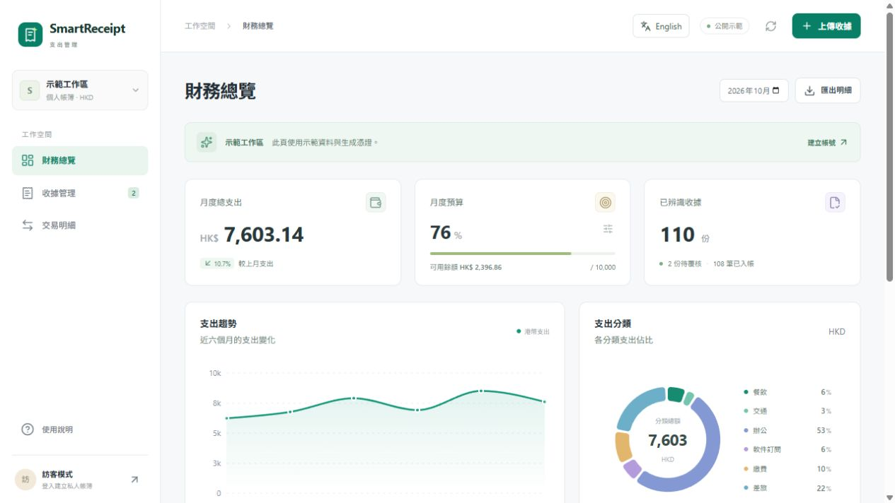

# SmartReceipt AI

面向個人與自由工作者的收據及支出管理工具。上傳圖片或 PDF，對照原圖覆核 AI 提取的欄位，再以歷史匯率折算港幣並確認入帳。

[公開示範](https://smartreceipt-ai-lime.vercel.app) · [English](README.md) · [使用指南](docs/START_HERE.md) · [實際驗收](docs/ACCEPTANCE.md)

**Next.js 16 · React 19 · TypeScript · Supabase Auth / PostgreSQL / Storage · DeepSeek Vision · Recharts · Tailwind CSS · Vercel**



公開頁面使用清楚標示的示範資料與生成憑證，毋須登入，也不會呼叫 AI。私人工作區已接通真實雲端服務；因尚未配置自訂 SMTP，目前採邀請制註冊。

## 功能

- JPG、PNG、PDF 批量上傳：每批最多 10 份，每份 10 MB，每份 PDF 最多 10 頁；多頁 PDF 視為一張收據。
- DeepSeek 提取商家、日期、總額、幣種、稅額與分類，原圖與可編輯表單並排顯示；確認前不進正式帳目。
- HKD／USD／CNY 歷史參考匯率，保存原幣、匯率、報價日、來源及港幣金額。
- 月度預算、六個曆月趨勢、分類圖表、交易修改／搜尋／篩選／排序／分頁及 CSV 匯出。
- 繁體中文／English 一鍵切換，記住選擇，切換時保留表單與篩選；圖表、錯誤提示及 CSV 欄名同步翻譯。
- 私人儲存、RLS、每日辨識額度、重試上限及重複確認保護。

## 設計重點

AI 草稿與正式帳目分開，避免未覆核資料進入統計。金額用 Decimal.js 與 PostgreSQL numeric 計算，歷史匯率由伺服器核對。入帳與額度預留使用資料庫原子操作；收據原檔直接上傳私人 Storage，僅在預覽或辨識時產生短效網址。

AI 使用 JSON mode 加 Zod 驗證，並非供應商保證遵守 JSON Schema 的 strict structured outputs。格式正確不等於內容正確，仍需要人對照原圖。完整資料流、RLS 與已知限制見 [ARCHITECTURE.md](docs/ARCHITECTURE.md)。

## 本機啟動

使用 Node.js 22.23 或以上的 22.x 版本：

```sh
git clone https://github.com/LeeWaiCheung/smartreceipt-ai.git
cd smartreceipt-ai
npm ci
npm run dev
```

打開 http://127.0.0.1:3000 。沒有憑證也能查看公開示範。Windows PowerShell 若阻擋 npm 腳本，改用 `npm.cmd`。

啟用私人帳簿需自行建立 Supabase、在新空白專案套用 migration，並以 [`.env.example`](.env.example) 建立 `.env.local`。也可使用開發專用的 `/setup` 頁面；正式環境會返回 404。詳細接入及部署步驟見 [SETUP.md](docs/SETUP.md)，不要把密鑰或私人收據提交到 Git。

## 驗證結果與邊界

`npm run verify` 執行 TypeScript 檢查、50 項本機測試及正式版建置；GitHub Actions 執行相同檢查，不需要服務密鑰。SQL 測試使用 PGlite，不冒充雲端驗收。

2026 年 10 月 21–22 日另完成真實 Supabase 27/27、公開 HTTPS 14/14、正式私人 API 32/32 檢查，以及桌面／手機瀏覽器核對。完整私人 UI 在本機連真實雲端驗收，正式公開 UI 另外驗收。

DeepSeek 真實評測包含 20 份自製清晰票據與兩個不確定案例。日期、總額、幣種各 20/20；分類有三份與標註不同。缺欄案例保留 null，模糊案例未達保守留空預期。**這不是真實香港收據的準確率。** 輸入與標註見 [fixtures/generated](fixtures/generated)，可分享摘要及未覆蓋範圍見 [ACCEPTANCE.md](docs/ACCEPTANCE.md)。

`npm run evaluate:ai` 會消耗自己的 API 額度；整合測試會在所設定的 Supabase 建立並清理臨時帳號。私人報告、密鑰、依賴及建置產物均不在 Git 內。

## 現有限制

這是個人作品集版本，沒有真實客戶或商業收入聲明。尚未提供公開註冊、忘記密碼、自助刪號／刪除原檔、持久工作佇列或大量資料的伺服器分頁。刪除交易會保留原檔及草稿；hash 只識別完全相同原檔，匯率可能與銀行結算不同。不包含多人組織帳簿、銀行對帳、複式簿記、訂閱付款或法定報稅。
